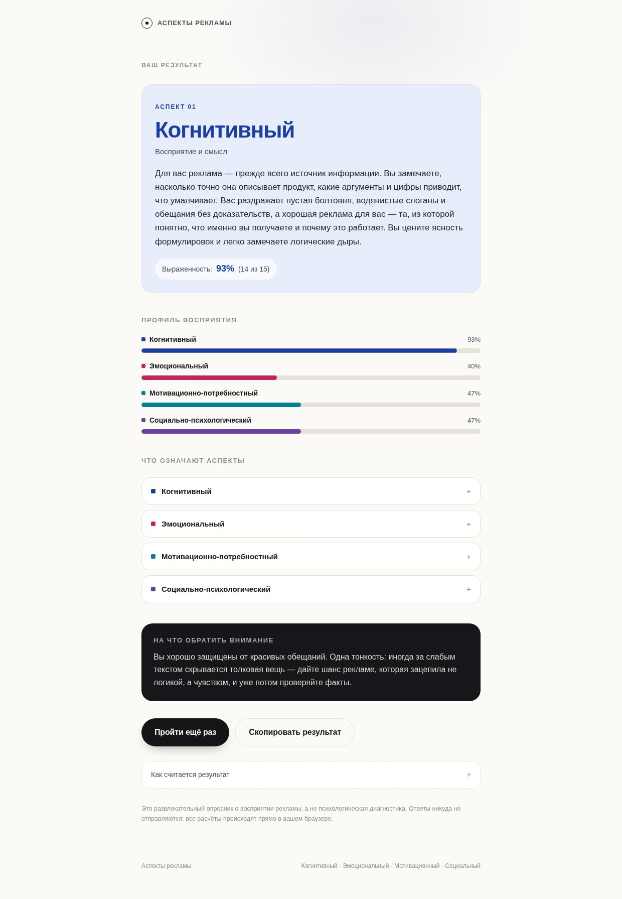

# Аспекты рекламы — мини-опросник

Небольшой анонимный тест в духе старых опросников из нулевых: 12 вопросов о том, как вы
смотрите рекламу, и в конце — личный профиль по четырём аспектам восприятия.

| Аспект | Что измеряет |
| --- | --- |
| **Когнитивный** | Восприятие и смысл: что именно говорит реклама, можно ли этому верить |
| **Эмоциональный** | Чувства и атмосфера: что реклама заставляет почувствовать |
| **Мотивационно-потребностный** | Польза и выгода: что покупка даст лично вам |
| **Социально-психологический** | Люди и окружение: как покупка выглядит со стороны |



## Что внутри

- **12 утверждений**, по 3 на каждый аспект, шкала согласия от «совсем не про меня» до «это точно про меня».
- **Современный минималистичный интерфейс**: крупная типографика, много воздуха, мягкие анимации.
- **Результат**: доминирующий аспект с подробным описанием + профиль всех четырёх в процентах.
- **Всё считается в браузере**, ответы никуда не отправляются, бэкенда нет.
- **Клавиатура**: ответы 1–5, `←` / `→` для навигации.
- Адаптивная вёрстка, поддержка `prefers-reduced-motion`, доступные `radiogroup` / `details`.

## Стек

Vanilla JS + [Vite](https://vitejs.dev). Ноль UI-зависимостей, шрифт Inter лежит локально.
Сборка — статические файлы в `dist/`, готовые и для Vercel, и для GitHub Pages.

```bash
npm install
npm run dev      # http://localhost:5173
npm run build    # dist/
npm run preview  # локальный просмотр сборки
```

## Структура

```
index.html          точка входа
src/main.js         логика экранов, подсчёт, рендер
src/data.js         ← аспекты, вопросы, шкала и тексты результатов
src/style.css       оформление
src/fonts.css       подключение локального Inter
```

## Как поменять вопросы

Все тексты живут в [`src/data.js`](src/data.js) — код трогать не нужно.

- **Вопрос** — объект `{ aspect: 'cognitive', text: '...' }`. `aspect` — один из ключей
  `cognitive`, `emotional`, `motivational`, `social`. Группы могут быть любой длины, но
  лучше держать их равными, иначе аспекты будут сравниваться нечестно.
- **Шкала** — массив `SCALE` (значения 1–5 и подписи).
- **Описания результатов** — блок `ASPECTS` (`title`, `tagline`, `short`, `description`).
- **Совет в конце** — объект `TIPS` в `src/main.js`.

Подсчёт: сумма ответов по группе, переведённая в проценты от максимума (число вопросов × 5).
Доминирующий аспект — с наибольшей суммой; при равенстве показываются оба.

## Деплой на Vercel

Репозиторий уже настроен: `vercel.json` с `framework: vite`, сборка `npm run build`, вывод `dist/`.

1. [vercel.com/new](https://vercel.com/new) → **Import Git Repository** → выбрать этот репозиторий.
2. Framework определится как **Vite** — ничего менять не нужно, нажать **Deploy**.
3. Получите адрес вида `ad-aspects-quiz.vercel.app`; дальше каждый `push` в `main` деплоится сам.

Или из терминала:

```bash
npm i -g vercel
vercel --prod
```

## Лицензия

Код — MIT. Шрифт Inter — SIL Open Font License.
